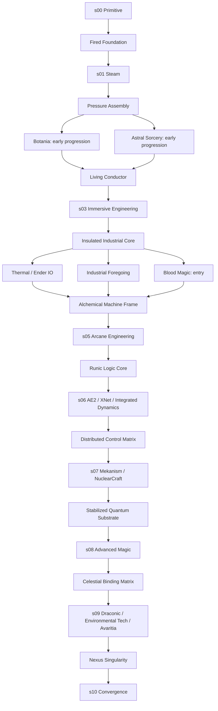

# Nexus Crucible — план техно-магической сборки Minecraft 1.12.2

**Предлагаю проект `Nexus Crucible`: техно-магическую Expert-сборку с 11 стадиями, обязательным чередованием технологий и магии и финальными крафтами 9×9. Ниже — проектный документ, а не готовый совместимый модпак: установщики и JAR не скачивались, конфиги, скрипты и Git-репозиторий не создавались.**

## Краткое резюме

1. **Платформа:** Minecraft 1.12.2, обычный Forge; без перехода на другой загрузчик без отдельного согласования.
2. **Forge:** кандидат — `14.23.5.2864`, но окончательный выбор блокируется до проверки официальных файлов и требований модов.
3. **Проверенная опорная версия:** существование `14.23.5.2860` подтверждается официальным changelog; это не утверждение, что она последняя или предпочтительная для релиза. [Официальный changelog Forge](https://maven.minecraftforge.net/net/minecraftforge/forge/1.12.2-14.23.5.2860/forge-1.12.2-14.23.5.2860-changelog.txt)
4. **Прогрессия:** `s00 → s10`, без обязательных циклических зависимостей.
5. **Технический стержень:** Immersive Engineering → Thermal/Ender IO → AE2 → Mekanism/NuclearCraft.
6. **Магический стержень:** Botania/Astral Sorcery → Blood Magic/Thaumcraft → объединённая поздняя магия.
7. **Большой крафт:** предварительно Avaritia; Extended Crafting — резервная замена, не второй параллельный обязательный верстак.
8. **Настройка:** CraftTweaker, ModTweaker, ContentTweaker, специализированные интеграции и конфиги.
9. **Объём:** реестр из **200 кандидатов**, а не обещание установить все 200 без проверки зависимостей и пересечений.
10. **Исполнение:** каждая фаза начинается только после отдельного утверждения; обнаруженный блокирующий риск останавливает затронутую ветку.

## Решения для уточнения

Это десять пунктов, без которых нельзя окончательно зафиксировать план. До их утверждения используются предложенные ниже значения по умолчанию.

| № | Что нужно определить | Предлагаемое значение |
|---|---|---|
| 1 | Техническое ядро: стандартный стек, Industrial Upgrade или GregTech CEu | Стандартный стек; Industrial Upgrade — отдельное решение |
| 2 | Соотношение технологий и магии | 60/40 |
| 3 | Длительность и гринд | Проектная цель 300–500 часов, сложная автоматизация вместо массового ручного крафта |
| 4 | Режим игры | Сингл и одна кооперативная команда из 2–4 игроков |
| 5 | Общая или индивидуальная прогрессия | Общая внутри одной команды; независимые команды пока вне гарантируемого объёма |
| 6 | Минимальное железо | Проектирование под ПК с 16 ГБ общей RAM; точный бюджет памяти — после измерений |
| 7 | Опасность мира и наказание за смерть | Умеренная опасность, могилы, без обязательного Hardcore |
| 8 | Обязательность исследования и боссов | Twilight Forest обязателен в ограниченном объёме; Ice and Fire — необязательная ветка |
| 9 | Допустимость рискованных компонентов | Thaumcraft 6, его аддоны и глубокие оптимизации — только после явного утверждения |
| 10 | Распространение и язык игрового обучения | Сначала частная сборка; квесты на русском, идентификаторы, код и имена файлов на английском |

**Отдельный блокер:** Industrial Upgrade не включён в основной список автоматически. Официальная страница сейчас описывает его как самостоятельный мод; считать любую его версию обычным аддоном к IC2 нельзя. Доступный пример интеграции CraftTweaker относится конкретно к `IndustrialUpgrade-1.12.2-3.3.0.38`, поэтому переносить его API на другую версию без проверки нельзя. [Репозиторий для разработчиков](https://github.com/ZelGimi/industrialupgrade-for-developers) [API-пример разработчиков](https://github.com/ZelGimi/industrialupgrade-for-developers/blob/master/crafttweaker_support.zs)

---

## Статус проектного документа

Документ имеет статус **`Proposal v0.1 — not approved`**.

Здесь используются три обозначения:

| Обозначение | Значение |
|---|---|
| **ПРОЕКТ** | Предлагаемое решение, а не установленный факт или уже реализованная механика |
| **ПОДТВЕРЖДЕНО ИСТОЧНИКОМ** | Название, наличие файла или возможность описаны в указанном источнике |
| **НЕ ПРОВЕРЕНО** | Не проверено на выбранном файле мода, в запущенной игре либо в целевом сочетании |

**Все точные версии модов, полное дерево их зависимостей, совместимость и разрешения на распространение пока НЕ ПРОВЕРЕНЫ.** Наличие мода в другой сборке подтверждает существование соответствующего файла, но не совместимость с будущим `Nexus Crucible`.

Для значительной части реестра использован опубликованный список файлов Enigmatica 2 Expert как проверяемый каталог названий и официальных ссылок. **Его версии, конфиги и рецепты не предлагается копировать:** текущий список содержит также компоненты другого runtime-профиля. [Опубликованный список файлов](https://github.com/EnigmaticaModpacks/Enigmatica2Expert/blob/master/MODLIST.md)

---

## Концепция и прогрессия

**Раздел 2.1.**

### Название и тон

**Название:** `Nexus Crucible`.

**Основная идея:** технологии дают точность, энергию и масштаб производства; магия — преобразование материалов, стабилизацию и доступ к следующему классу компонентов. Ни одно направление не должно превращаться в необязательную декоративную ветку.

**Проектная длительность:** 300–500 часов первого прохождения в одиночку. Это целевой диапазон для балансировки, а не измеренная продолжительность.

**Характер сложности:**

- Сложно построить правильную производственную цепочку.
- Несложно повторить уже автоматизированный процесс.
- Ранние фабрики остаются полезными до финала.
- Исследование требуется для открытия механик, но не для бесконечного поиска редких случайных сундуков.
- Босс не должен быть единственным невозобновляемым источником компонента, который затем нужен тысячами.

### Стадии

**Все названия гейт-предметов ниже — проектируемые собственные предметы, а не существующие registry ID.** Их фактические идентификаторы появятся только после регистрации и дампа.

| Стадия | Цель | Ключевые моды и механики | Гейт следующего этапа | Что открывается |
|---|---|---|---|---|
| `s00 Primitive` | Ручные инструменты, базовые материалы, первая плавка | Tinkers’ Construct, ограниченный Tinkers’ Complement, Clay Bucket | `Fired Foundation` | Контролируемая металлургия |
| `s01 Steam` | Получить первые стабильные промышленные материалы | Tinkers, ранние механизмы Thermal, коксовая ветка IE | `Pressure Assembly` | Начальная магия |
| `s02 Awakened Nature` | Освоить ману и начальное звёздное развитие | Botania, ранняя Astral Sorcery | `Living Conductor` | Электромеханика |
| `s03 Electromechanics` | Построить первую электрическую инфраструктуру | Immersive Engineering, ограниченный Actually Additions | `Insulated Industrial Core` | Полноценная обработка ресурсов |
| `s04 Industrial Chemistry` | Наладить сплавы, жидкости, пластики и промышленное производство | Thermal Expansion, Ender IO, Industrial Foregoing; начало Blood Magic | `Alchemical Machine Frame` | Глубокая магическая интеграция |
| `s05 Arcane Engineering` | Объединить промышленную обработку с ритуалами и исследованиями | Blood Magic, Thaumcraft, промежуточная Botania | `Runic Logic Core` | Цифровая логистика |
| `s06 Networked Factory` | Организовать хранение и воспроизводимый автокрафт | AE2, XNet, Integrated Dynamics/Tunnels | `Distributed Control Matrix` | Продвинутая энергетика |
| `s07 Advanced Industry` | Создать энергоёмкие производственные цепи | Mekanism, NuclearCraft, RFTools Control | `Stabilized Quantum Substrate` | Высшая магия |
| `s08 Celestial Synthesis` | Освоить верхние уровни выбранных магических систем | Поздние Botania, Astral Sorcery, Blood Magic, Thaumcraft | `Celestial Binding Matrix` | Поздние техно-магические системы и 9×9 |
| `s09 Stellar Engineering` | Свести массовое производство и редкие преобразования | Draconic Evolution, Environmental Tech, ограниченная Mystical Agriculture, Avaritia | `Nexus Singularity` | Финальные проекты |
| `s10 Convergence` | Завершить объединённую производственную систему | Avaritia и собственные финальные рецепты | `Convergence Core` | Завершение; опциональные творческие награды |

**Важно для `s01`:** название Steam не означает, что у Immersive Engineering предполагается несуществующая универсальная паровая инфраструктура. Конкретный ранний источник энергии, его рецепт и доступные механизмы выбираются по фактическим возможностям закреплённых версий.

**Важно для Thaumcraft:** в опубликованном каталоге присутствует файл `6.1.BETA26`. Это основание считать его отдельным риском, а не обещать беспроблемную обязательную ветку. До утверждения допуска этого риска зависимые переходы остаются проектными. [Официальный файл Thaumcraft](https://www.curseforge.com/minecraft/mc-mods/thaumcraft/files/2629023)

### Граф зависимостей



### Правила переходов

1. **Разблокировка и стоимость — разные сущности.** Открытие стадии сохраняется, но компоненты предыдущих производств продолжают расходоваться.
2. **Квест не заменяет физическую цепочку.** Нельзя открыть этап только кнопкой подтверждения или знанием названия команды.
3. **Начальный bootstrap — осознанное исключение.** Первые инструменты и материалы не могут требовать ещё недоступную магию.
4. **Взаимность направлений строится через стадии, а не через циклы.** Ранняя магия помогает ранней промышленности, поздняя промышленность — поздней магии.
5. **Личные ограничения не считаются защитой общей фабрики.** Передача предметов, общие контейнеры и машины проверяются отдельно.
6. **Рекомендуемый первый релиз — одна кооперативная команда.** Изолированная прогрессия нескольких команд требует дополнительного проекта и испытаний.

---

## Реестр модов

**Раздел 2.2.**

### Как читать таблицы

Это **200 кандидатов на проверку**, разделённых по назначению.

- Категории: `tech`, `magic`, `world`, `QoL`, `lib`, `optimization`.
- Стадия означает момент доступности ключевой функции, **не момент загрузки JAR**.
- `all` — инфраструктурный компонент.
- В зависимостях перечислены основные ожидаемые связи; окончательные зависимости конкретного файла **НЕ ПРОВЕРЕНЫ**.
- `?` — зависимость нужно установить по официальному файлу и метаданным.
- Риски: **Н** — низкий ожидаемый; **С** — требует интеграционного теста; **В** — повышенный или способен нарушить прогрессию.
- Ссылка — официальная страница проекта, **не разрешение на автоматическое скачивание и не фиксация версии**.

В финальном профиле допустимо получить, например, 190 или 205 JAR. Добавлять бесполезные библиотеки ради ровного числа 200 нельзя.

### Технологии и автоматизация

| № | Мод | Категория | Стадия | Основные зависимости | Зачем | Риск | Источник |
|---|---|---|---|---|---|---|---|
| 1 | Tinkers’ Construct | tech | 00 | Mantle | Инструменты и металлургия | С: ранние сплавы | [CF](https://www.curseforge.com/minecraft/mc-mods/tinkers-construct) |
| 2 | Tinkers’ Complement | tech | 00–01 | Tinkers | Ранняя обработка | С: bootstrap | [CF](https://www.curseforge.com/minecraft/mc-mods/tinkers-complement) |
| 3 | Tinker I/O | tech | 04 | Tinkers | Поздняя автоматизация литья | С | [CF](https://www.curseforge.com/minecraft/mc-mods/tinker-i-o) |
| 4 | Thermal Foundation | tech | 01+ | CoFH Core, RF; ? | Базовые материалы | С: дубли руд | [CF](https://www.curseforge.com/minecraft/mc-mods/thermal-foundation) |
| 5 | Thermal Expansion | tech | 01, 04+ | Thermal Foundation; ? | Ранняя энергетика и поздние машины | В: альтернативные процессы | [CF](https://www.curseforge.com/minecraft/mc-mods/thermal-expansion) |
| 6 | Thermal Dynamics | tech | 04 | CoFH/Thermal; ? | Трубопроводы | С | [CF](https://www.curseforge.com/minecraft/mc-mods/thermal-dynamics) |
| 7 | Thermal Cultivation | tech | 03 | CoFH/Thermal; ? | Управляемое земледелие | Н | [CF](https://www.curseforge.com/minecraft/mc-mods/thermal-cultivation) |
| 8 | Redstone Arsenal | tech | 07 | CoFH/Thermal; ? | Энергетические инструменты | С: баланс | [CF](https://www.curseforge.com/minecraft/mc-mods/redstone-arsenal) |
| 9 | Immersive Engineering | tech | 01, 03+ | ? | Основная ранняя промышленность | С | [CF](https://www.curseforge.com/minecraft/mc-mods/immersive-engineering) |
| 10 | Immersive Petroleum | tech | 04 | IE | Нефтепереработка | С: жидкости | [CF](https://www.curseforge.com/minecraft/mc-mods/immersive-petroleum) |
| 11 | MCT Immersive Technology | tech | 07 | IE; ? | Крупная промышленная инфраструктура | В: пересечения | [CF](https://www.curseforge.com/minecraft/mc-mods/mct-immersive-technology) |
| 12 | Engineer’s Doors | QoL | 03 | IE | Декор промышленной базы | Н | [CF](https://www.curseforge.com/minecraft/mc-mods/engineers-doors) |
| 13 | Actually Additions | tech | 03+ | ? | Отдельные производственные операции | В: дешёвые обходы | [CF](https://www.curseforge.com/minecraft/mc-mods/actually-additions) |
| 14 | Actually Baubles | QoL | 03 | Actually Additions, Baubles; ? | Аксессуары | С | [CF](https://www.curseforge.com/minecraft/mc-mods/actually-baubles) |
| 15 | Ender IO | tech | 04 | EnderCore; ? | Сплавы и логистика | В: альтернативные рецепты | [CF](https://www.curseforge.com/minecraft/mc-mods/ender-io) |
| 16 | Ender IO Endergy | tech | 07 | Ender IO | Поздние уровни оборудования | С | [CF](https://www.curseforge.com/minecraft/mc-mods/ender-io-endergy) |
| 17 | Gas Conduits | tech | 07 | Ender IO, Mekanism | Газовая логистика | С: API | [CF](https://www.curseforge.com/minecraft/mc-mods/gas-conduits) |
| 18 | Industrial Foregoing | tech | 04+ | Tesla Core Lib; ? | Фермы и промышленное производство | В: добыча ресурсов | [CF](https://www.curseforge.com/minecraft/mc-mods/industrial-foregoing) |
| 19 | Integration Foregoing | tech | 06 | IF и интегрируемые моды; ? | Межмодовая автоматизация | С | [CF](https://www.curseforge.com/minecraft/mc-mods/integration-foregoing) |
| 20 | Mekanism | tech | 07 | ? | Поздняя обработка и химия | В: множители руд | [CF](https://www.curseforge.com/minecraft/mc-mods/mekanism) |
| 21 | Mekanism Generators | tech | 07 | Mekanism | Продвинутая генерация | В: энергетический баланс | [CF](https://www.curseforge.com/minecraft/mc-mods/mekanism-generators) |
| 22 | NuclearCraft | tech | 07 | ? | Реакторная и материальная ветка | В: версия, рецепты | [CF](https://www.curseforge.com/minecraft/mc-mods/nuclearcraft-mod) |
| 23 | Advanced Generators | tech | 07 | bdlib | Масштабируемая энергетика | С: эффективность топлива | [CF](https://www.curseforge.com/minecraft/mc-mods/advanced-generators) |
| 24 | Forestry | tech | 03+ | ? | Фермы и пчеловодство | С: ресурсы | [CF](https://www.curseforge.com/minecraft/mc-mods/forestry) |
| 25 | Gendustry | tech | 07 | Forestry, bdlib; ? | Поздняя автоматизация пчёл | В: ускорение ресурсов | [CF](https://www.curseforge.com/minecraft/mc-mods/gendustry) |
| 26 | Applied Energistics 2 | tech | 06 | ? | Основной цифровой склад | С: автокрафт | [CF](https://www.curseforge.com/minecraft/mc-mods/applied-energistics-2) |
| 27 | AE2 Stuff | tech | 06 | AE2, bdlib | Дополнительная инфраструктура AE2 | С | [CF](https://www.curseforge.com/minecraft/mc-mods/ae2-stuff) |
| 28 | Wireless Crafting Terminal | tech | 07 | AE2WTLib; ? | Поздний беспроводной доступ | С | [CF](https://www.curseforge.com/minecraft/mc-mods/wireless-crafting-terminal) |
| 29 | PackagedAuto | tech | 09 | AE2; ? | Крупные пакетные процессы | В: 9×9 и автоматизация | [CF](https://www.curseforge.com/minecraft/mc-mods/packagedauto) |
| 30 | XNet | tech | 06 | McJtyLib | Компактная логистика | С | [CF](https://www.curseforge.com/minecraft/mc-mods/xnet) |
| 31 | Integrated Dynamics | tech | 06 | Cyclops Core, CommonCapabilities; ? | Программируемая логика | С | [CF](https://www.curseforge.com/minecraft/mc-mods/integrated-dynamics) |
| 32 | Integrated Tunnels | tech | 06 | Integrated Dynamics | Управляемые потоки | В: взаимодействие с ограничениями | [CF](https://www.curseforge.com/minecraft/mc-mods/integrated-tunnels) |
| 33 | Integrated NBT | tech | 07 | Integrated Dynamics; ? | Продвинутая обработка данных | С | [CF](https://www.curseforge.com/minecraft/mc-mods/integrated-nbt) |
| 34 | CC: Tweaked | tech | 06 | ? | Программирование фабрик | С: серверная безопасность | [CF](https://www.curseforge.com/minecraft/mc-mods/cc-tweaked) |
| 35 | OpenComputers | tech | 07 | ? | Альтернативная вычислительная ветка | С: объём и пересечения | [CF](https://www.curseforge.com/minecraft/mc-mods/opencomputers) |
| 36 | Plethora Peripherals | tech | 07 | CC: Tweaked; ? | Датчики и периферия | В: полномочия устройств | [CF](https://www.curseforge.com/minecraft/mc-mods/plethora-peripherals) |
| 37 | RFTools | tech | 06–08 | McJtyLib | Сервисные машины | В: Builder и добыча | [CF](https://www.curseforge.com/minecraft/mc-mods/rftools) |
| 38 | RFTools Control | tech | 07 | RFTools, McJtyLib | Позднее управление процессами | С | [CF](https://www.curseforge.com/minecraft/mc-mods/rftools-control) |
| 39 | Compact Machines | tech | 07 | ? | Модульные фабрики | В: измерения и загрузка | [CF](https://www.curseforge.com/minecraft/mc-mods/compact-machines) |
| 40 | EnderStorage | tech | 06 | CodeChicken Lib | Межпространственная логистика | В: общие каналы | [CF](https://www.curseforge.com/minecraft/mc-mods/ender-storage-1-8) |
| 41 | Storage Drawers | tech | 01+ | Chameleon | Ранний массовый склад | С: конверсии | [CF](https://www.curseforge.com/minecraft/mc-mods/storage-drawers) |
| 42 | Framed Compacting Drawers | QoL | 04 | Storage Drawers; ? | Декоративные компактирующие ящики | С: конверсии | [CF](https://www.curseforge.com/minecraft/mc-mods/framed-compacting-drawers) |
| 43 | Iron Chests | QoL | 01 | ? | Промежуточное хранение | Н | [CF](https://www.curseforge.com/minecraft/mc-mods/iron-chests) |
| 44 | Flux Networks | tech | 07 | ? | Поздняя передача энергии | В: энергетические обходы | [CF](https://www.curseforge.com/minecraft/mc-mods/flux-networks) |
| 45 | Modular Machinery | tech | 05+ | ? | Собственные многоблочные процессы | В: API и автоматизация | [CF](https://www.curseforge.com/minecraft/mc-mods/modular-machinery) |

### Магия и финальные системы

| № | Мод | Категория | Стадия | Основные зависимости | Зачем | Риск | Источник |
|---|---|---|---|---|---|---|---|
| 46 | Botania | magic | 02+ | Baubles; ? | Основная природная магия | С: ресурсные преобразования | [CF](https://www.curseforge.com/minecraft/mc-mods/botania) |
| 47 | Astral Sorcery | magic | 02+ | ? | Небесная ветка | В: генерация и усиления | [CF](https://www.curseforge.com/minecraft/mc-mods/astral-sorcery) |
| 48 | Blood Magic | magic | 04+ | Guide-API; ? | Ритуалы и расходные компоненты | В: автоматизация | [CF](https://www.curseforge.com/minecraft/mc-mods/blood-magic) |
| 49 | Animus | magic | 08 | Blood Magic | Необязательные поздние инструменты | В: баланс | [CF](https://www.curseforge.com/minecraft/mc-mods/animus) |
| 50 | Thaumcraft | magic | 05+ | Baubles; ? | Исследования и инфузия | В: beta, обязательный апрув | [CF](https://www.curseforge.com/minecraft/mc-mods/thaumcraft) |
| 51 | Thaumic Tinkerer | magic | 08 | Thaumcraft | Необязательный поздний контент | В: стабильность | [CF](https://www.curseforge.com/minecraft/mc-mods/thaumic-tinkerer) |
| 52 | Psi | magic | 07 | AutoRegLib; ? | Программируемые заклинания | В: обход добычи и боя | [CF](https://www.curseforge.com/minecraft/mc-mods/psi) |
| 53 | Avaritia | tech | 09–10 | CodeChicken Lib; ? | Основной кандидат на 9×9 | В: стандартные OP-рецепты | [CF](https://www.curseforge.com/minecraft/mc-mods/avaritia-1-10) |
| 54 | Draconic Evolution | tech | 09 | Brandon’s Core; ? | Поздняя энергетика и босс | В: резкий рост силы | [CF](https://www.curseforge.com/minecraft/mc-mods/draconic-evolution) |
| 55 | Environmental Tech | tech | 09 | ValkyrieLib | Массовое позднее производство | В: void-добыча | [CF](https://www.curseforge.com/minecraft/mc-mods/environmental-tech) |
| 56 | Environmental Materials | QoL | 03 | ValkyrieLib; ? | Совместимый строительный набор | Н | [CF](https://www.curseforge.com/minecraft/mc-mods/environmental-materials) |
| 57 | Mystical Agriculture | magic | 09 | ? | Позднее возобновление базовых ресурсов | В: обход всей добычи | [CF](https://www.curseforge.com/minecraft/mc-mods/mystical-agriculture) |
| 58 | Mystical Agradditions | magic | 09–10 | Mystical Agriculture | Поздние уровни аграрной ветки | В: баланс | [CF](https://www.curseforge.com/minecraft/mc-mods/mystical-agradditions) |
| 59 | MystAgrad Cloche Compat | tech | 09 | MA, IE; ? | Контролируемая автоматизация растений | В: производительность | [CF](https://www.curseforge.com/minecraft/mc-mods/mystagrad-cloche-compat) |
| 60 | Akashic Tome | QoL | 00 | AutoRegLib; ? | Объединение руководств | Н | [CF](https://www.curseforge.com/minecraft/mc-mods/akashic-tome) |
| 61 | Morph-o-Tool | QoL | 04 | AutoRegLib; ? | Объединение инструментов настройки | С: NBT | [CF](https://www.curseforge.com/minecraft/mc-mods/morph-o-tool) |
| 62 | Thaumic Computers | tech | 08 | Thaumcraft, OpenComputers | Программная магическая интеграция | В: API | [CF](https://www.curseforge.com/minecraft/mc-mods/thaumic-computers) |

### Мир, существа и выживание

| № | Мод | Категория | Стадия | Основные зависимости | Зачем | Риск | Источник |
|---|---|---|---|---|---|---|---|
| 63 | Biomes O’ Plenty | world | 00 | ? | Единственный основной расширитель биомов | В: worldgen | [CF](https://www.curseforge.com/minecraft/mc-mods/biomes-o-plenty) |
| 64 | CoFH World | world | all | CoFH Core; ? | Централизованная генерация руд | В: конфиги мира | [CF](https://www.curseforge.com/minecraft/mc-mods/cofh-world) |
| 65 | The Twilight Forest | world | 05+ | ? | Исследование и ограниченная босс-ветка | С: порталы | [CF](https://www.curseforge.com/minecraft/mc-mods/the-twilight-forest) |
| 66 | Ice and Fire | world | 00, 05+ | LLibrary; ? | Необязательные опасности и боссы | В: разрушения, генерация | [CF](https://www.curseforge.com/minecraft/mc-mods/ice-and-fire-dragons) |
| 67 | In Control! | world | all | ? | Правила спавна и дропа | С | [CF](https://www.curseforge.com/minecraft/mc-mods/in-control) |
| 68 | Recurrent Complex | world | 00+ | IvToolkit | Настраиваемые структуры | В: лут и worldgen | [CF](https://www.curseforge.com/minecraft/mc-mods/recurrent-complex) |
| 69 | Rustic | world | 00 | ? | Ранняя бытовая и аграрная ветка | Н | [CF](https://www.curseforge.com/minecraft/mc-mods/rustic) |
| 70 | Pam’s HarvestCraft | world | 00 | ? | Разнообразие еды | С: разрастание рецептов | [CF](https://www.curseforge.com/minecraft/mc-mods/pams-harvestcraft) |
| 71 | Cooking for Blockheads | QoL | 01 | ? | Удобная кухня | Н | [CF](https://www.curseforge.com/minecraft/mc-mods/cooking-for-blockheads) |
| 72 | Farming for Blockheads | QoL | 02 | ? | Контролируемый доступ к семенам | С: торговые обходы | [CF](https://www.curseforge.com/minecraft/mc-mods/farming-for-blockheads) |
| 73 | Nature’s Compass | QoL | 02 | ? | Уменьшение случайного поиска биомов | Н | [CF](https://www.curseforge.com/minecraft/mc-mods/natures-compass) |
| 74 | Scannable | tech | 06 | ? | Поздний поиск ресурсов | С: ранняя разведка | [CF](https://www.curseforge.com/minecraft/mc-mods/scannable) |
| 75 | EmberRoot Zoo | world | 00+ | CraftStudio API; ? | Дополнительные существа | С: спавн | [CF](https://www.curseforge.com/minecraft/mc-mods/emberroot-zoo) |
| 76 | No Mob Spawning on Trees | world | all | ? | Контроль спавна | С: пересечения правил | [CF](https://www.curseforge.com/minecraft/mc-mods/no-mob-spawning-on-trees) |
| 77 | Pretty Beaches | world | 00 | ? | Меньше повреждений берегов | Н | [CF](https://www.curseforge.com/minecraft/mc-mods/pretty-beaches) |
| 78 | Quick Leaf Decay | QoL | 00 | ? | Сокращение бытового ожидания | С: пересечение с UT | [CF](https://www.curseforge.com/minecraft/mc-mods/quick-leaf-decay) |
| 79 | Clay Bucket | QoL | 00 | ? | Раннее ограниченное ведро | С: bootstrap | [CF](https://www.curseforge.com/minecraft/mc-mods/clay-bucket) |
| 80 | Tool Progression | tech | all | ? | Контроль уровней добычи | В: softlock | [CF](https://www.curseforge.com/minecraft/mc-mods/tool-progression) |

### Карта, интерфейс и строительство

| № | Мод | Категория | Стадия | Основные зависимости | Зачем | Риск | Источник |
|---|---|---|---|---|---|---|---|
| 81 | Just Enough Items | QoL | all | ? | Просмотр рецептов | С: интеграции | [CF](https://www.curseforge.com/minecraft/mc-mods/jei) |
| 82 | Just Enough Resources | QoL | all | JEI | Информация о ресурсах | Н | [CF](https://www.curseforge.com/minecraft/mc-mods/just-enough-resources-jer) |
| 83 | JEI Bees | QoL | 03 | JEI, Forestry | Информация о пчёлах | Н | [CF](https://www.curseforge.com/minecraft/mc-mods/jei-bees) |
| 84 | JEI Villagers | QoL | all | JEI | Прозрачность торговли | Н | [CF](https://www.curseforge.com/minecraft/mc-mods/jei-villagers) |
| 85 | JETIF | QoL | 05 | JEI, Twilight Forest | Информация об исследовательской ветке | Н | [CF](https://www.curseforge.com/minecraft/mc-mods/jetif) |
| 86 | Just Enough Petroleum | QoL | 04 | JEI, Immersive Petroleum | Рецепты нефтепереработки | Н | [CF](https://www.curseforge.com/minecraft/mc-mods/just-enough-petroleum) |
| 87 | Gendustry JEI Addon | QoL | 07 | JEI, Gendustry | Рецепты генетики | Н | [CF](https://www.curseforge.com/minecraft/mc-mods/gendustry-jei-addon) |
| 88 | Tinkers’ JEI | QoL | 00 | JEI, Tinkers | Справка по инструментам | Н | [CF](https://www.curseforge.com/minecraft/mc-mods/tinkers-jei) |
| 89 | Thaumic JEI | QoL | 05 | JEI, Thaumcraft | Магические рецепты | С: версия интеграции | [CF](https://www.curseforge.com/minecraft/mc-mods/thaumic-jei) |
| 90 | Thaumcraft 6 Aspects for JEI | QoL | 05 | JEI, Thaumcraft | Аспекты; оставить только при непересечении | С: дубли функций | [CF](https://www.curseforge.com/minecraft/mc-mods/thaumcraft-6-aspects-for-jei) |
| 91 | BloodMagic Meteors JEI Support | QoL | 08 | JEI, Blood Magic | Прозрачность метеорных ресурсов | С | [CF](https://www.curseforge.com/minecraft/mc-mods/bloodmagic-meteors-jei-support) |
| 92 | Just Enough HarvestCraft | QoL | 00 | JEI, HarvestCraft | Кулинарная справка | Н | [CF](https://www.curseforge.com/minecraft/mc-mods/just-enough-harvestcraft) |
| 93 | Just Enough Energistics | QoL | 06 | JEI, AE2 | Удобство шаблонов автокрафта | С | [CF](https://www.curseforge.com/minecraft/mc-mods/just-enough-energistics-jee) |
| 94 | Hwyla | QoL | all | ? | Подсказки по блокам | Н | [CF](https://www.curseforge.com/minecraft/mc-mods/hwyla) |
| 95 | Waila Harvestability | QoL | all | Hwyla | Требования к добыче | Н | [CF](https://www.curseforge.com/minecraft/mc-mods/waila-harvestability) |
| 96 | Wawla | QoL | all | Hwyla; ? | Дополнительные подсказки | С: дубли | [CF](https://www.curseforge.com/minecraft/mc-mods/wawla) |
| 97 | JourneyMap | QoL | all | ? | Единственная основная карта | С: серверные правила | [CF](https://www.curseforge.com/minecraft/mc-mods/journeymap) |
| 98 | Inventory Tweaks | QoL | all | ? | Сортировка | С: специальные контейнеры | [CF](https://www.curseforge.com/minecraft/mc-mods/inventory-tweaks) |
| 99 | Mouse Tweaks Unofficial | QoL | all | ? | Работа со слотами | С: контейнеры, runtime | [CF](https://www.curseforge.com/minecraft/mc-mods/mouse-tweaks-unofficial) |
| 100 | Controlling | QoL | all | ? | Поиск конфликтов клавиш | Н | [CF](https://www.curseforge.com/minecraft/mc-mods/controlling) |
| 101 | Better Advancements | QoL | all | ? | Удобный просмотр достижений | С: пересечение с UT | [CF](https://www.curseforge.com/minecraft/mc-mods/better-advancements) |
| 102 | Better Builder’s Wands | QoL | 03 | ? | Строительство без ранней автоматизации | С: стоимость | [CF](https://www.curseforge.com/minecraft/mc-mods/better-builders-wands) |
| 103 | Building Gadgets | QoL | 06 | ? | Позднее массовое строительство | С: права и энергия | [CF](https://www.curseforge.com/minecraft/mc-mods/building-gadgets) |
| 104 | Carry On | QoL | 00 | ? | Перенос разрешённых контейнеров | В: обход стадий | [CF](https://www.curseforge.com/minecraft/mc-mods/carry-on) |
| 105 | Backpacks | QoL | 01 | ? | Походное хранение | С: NBT | [CF](https://www.curseforge.com/minecraft/mc-mods/forge-backpacks) |
| 106 | /dank/null | QoL | 04 | p455w0rd’s Library; ? | Массовые строительные материалы | С: конверсии и NBT | [CF](https://www.curseforge.com/minecraft/mc-mods/dank-null) |
| 107 | Ore Excavation | QoL | 03 | ? | Уменьшение повторной ручной добычи | В: обход уровней | [CF](https://www.curseforge.com/minecraft/mc-mods/ore-excavation) |
| 108 | Broken Wings | QoL | all | ? | Контроль доступности полёта | С: интеграции | [CF](https://www.curseforge.com/minecraft/mc-mods/broken-wings) |
| 109 | Tomb Many Graves 2 | QoL | all | ? | Восстановление после смерти | С: аксессуары и NBT | [CF](https://www.curseforge.com/minecraft/mc-mods/tomb-many-graves-2) |
| 110 | Cosmetic Armor Reworked | QoL | all | ? | Внешний вид без изменения баланса | Н | [CF](https://www.curseforge.com/minecraft/mc-mods/cosmetic-armor-reworked) |
| 111 | AppleSkin | QoL | all | ? | Информация о еде | Н | [CF](https://www.curseforge.com/minecraft/mc-mods/appleskin) |
| 112 | AppleCore | lib | all | ? | Пищевая API-инфраструктура, если нужна | Н | [CF](https://www.curseforge.com/minecraft/mc-mods/applecore) |
| 113 | Spice of Life: Carrot Edition | QoL | all | ? | Необязательное поощрение разнообразия | С: баланс здоровья | [CF](https://www.curseforge.com/minecraft/mc-mods/spice-of-life-carrot-edition) |
| 114 | Neat | QoL | all | AutoRegLib; ? | Единственный основной индикатор здоровья | Н | [CF](https://www.curseforge.com/minecraft/mc-mods/neat) |
| 115 | Armor Toughness Bar | QoL | all | ? | Читаемость защиты | Н | [CF](https://www.curseforge.com/minecraft/mc-mods/armor-toughness-bar) |
| 116 | Overloaded Armor Bar | QoL | all | ? | Отображение высокой брони | Н | [CF](https://www.curseforge.com/minecraft/mc-mods/overloaded-armor-bar) |
| 117 | No NV Flash | QoL | all | ? | Комфорт ночного зрения | С: пересечение с UT | [CF](https://www.curseforge.com/minecraft/mc-mods/no-nv-flash) |
| 118 | Super Sound Muffler: Revived | QoL | 03 | ? | Контроль шума фабрики | Н | [CF](https://www.curseforge.com/minecraft/mc-mods/super-sound-muffler-revived) |
| 119 | Ding | QoL | all | ? | Уведомление об окончании загрузки | Н | [CF](https://www.curseforge.com/minecraft/mc-mods/ding) |
| 120 | More Overlays | QoL | all | ? | Строительные оверлеи | Н | [CF](https://www.curseforge.com/minecraft/mc-mods/more-overlays) |
| 121 | Chisel | QoL | 01 | CTM; ? | Основной декоративный набор | С: конверсии блоков | [CF](https://www.curseforge.com/minecraft/mc-mods/chisel) |
| 122 | Unlimited Chisel Works | QoL | 01 | Chisel; ? | Декор материалов других модов | С: число блоков | [CF](https://www.curseforge.com/minecraft/mc-mods/unlimited-chisel-works) |
| 123 | ArchitectureCraft | QoL | 03 | ? | Архитектурные формы | С: рендер | [CF](https://www.curseforge.com/minecraft/mc-mods/architecturecraft-tridev) |
| 124 | Blockcraftery | QoL | 01 | ? | Каркасные строительные блоки | С: реальная библиотека | [CF](https://www.curseforge.com/minecraft/mc-mods/blockcraftery) |
| 125 | Flat Colored Blocks | QoL | 01 | ? | Цветовое оформление базы | С: объём реестра | [CF](https://www.curseforge.com/minecraft/mc-mods/flat-colored-blocks-forge) |
| 126 | KleeSlabs | QoL | all | ? | Удобная работа с плитами | Н | [CF](https://www.curseforge.com/minecraft/mc-mods/kleeslabs) |
| 127 | Quark | QoL | all | AutoRegLib | Выборочные бытовые улучшения | В: отключать лишние механики | [CF](https://www.curseforge.com/minecraft/mc-mods/quark) |
| 128 | BiblioCraft | QoL | 01+ | ? | Библиотеки и оформление | В: печать и конверсии | [CF](https://www.curseforge.com/minecraft/mc-mods/bibliocraft) |
| 129 | Custom Main Menu | QoL | all | ? | Меню и информация о версии | Н | [CF](https://www.curseforge.com/minecraft/mc-mods/custom-main-menu) |
| 130 | Custom Backgrounds | QoL | all | ? | Оформление интерфейса | Н | [CF](https://www.curseforge.com/minecraft/mc-mods/custom-backgrounds) |
| 131 | Resource Loader | QoL | all | ? | Собственные ресурсы оформления | С: лицензии ресурсов | [CF](https://www.curseforge.com/minecraft/mc-mods/resource-loader) |
| 132 | Default Options | QoL | all | ? | Воспроизводимые начальные настройки | Н | [CF](https://www.curseforge.com/minecraft/mc-mods/default-options) |
| 133 | ReAuth | QoL | all | ? | Повторная авторизация | С: безопасность | [CF](https://www.curseforge.com/minecraft/mc-mods/reauth) |
| 134 | Tips | QoL | all | Bookshelf; ? | Подсказки при загрузке | Н | [CF](https://www.curseforge.com/minecraft/mc-mods/tips) |
| 135 | Toast Control | QoL | all | Placebo; ? | Контроль уведомлений | С: пересечение с UT | [CF](https://www.curseforge.com/minecraft/mc-mods/toast-control) |
| 136 | TipTheScales | QoL | all | ? | Настройка масштаба интерфейса | Н | [CF](https://www.curseforge.com/minecraft/mc-mods/tipthescales) |
| 137 | Demagnetize | QoL | 04 | ? | Защита процессов от магнитов | С: интеграции | [CF](https://www.curseforge.com/minecraft/mc-mods/demagnetize) |
| 138 | Anger Management | QoL | all | ? | Контроль раздражающих боевых ситуаций | С: правила мобов | [CF](https://www.curseforge.com/minecraft/mc-mods/anger-management) |
| 139 | Villager Market | QoL | 04 | ? | Удобная торговля после аудита | В: обход ресурсных гейтов | [CF](https://www.curseforge.com/minecraft/mc-mods/villager-market) |
| 140 | Simple Trophies | QoL | 05+ | ? | Нефункциональные награды | Н | [CF](https://www.curseforge.com/minecraft/mc-mods/simple-trophies) |

### Квесты и настройка

| № | Мод | Категория | Стадия | Основные зависимости | Зачем | Риск | Источник |
|---|---|---|---|---|---|---|---|
| 141 | Better Questing | QoL | all | ? | Основная квестовая система | В: команды и команда игроков | [CF](https://www.curseforge.com/minecraft/mc-mods/better-questing) |
| 142 | Better Questing: Standard Expansion | QoL | all | Better Questing | Задачи и награды | С | [CF](https://www.curseforge.com/minecraft/mc-mods/better-questing-standard-expansion) |
| 143 | Better Questing: Quest Book | QoL | all | Better Questing | Книга квестов | Н | [CF](https://www.curseforge.com/minecraft/mc-mods/better-questing-quest-book) |
| 144 | Patchouli | QoL | all | ? | Авторское руководство | С: формат старой ветки | [CF](https://www.curseforge.com/minecraft/mc-mods/patchouli) |
| 145 | CraftTweaker | tech | all | ? | Основные рецепты и сценарии | В: ошибки скриптов | [CF](https://www.curseforge.com/minecraft/mc-mods/crafttweaker) |
| 146 | ModTweaker | tech | all | CraftTweaker, MTLib | Поддерживаемые машинные рецепты | В: покрытие API | [CF](https://www.curseforge.com/minecraft/mc-mods/modtweaker) |
| 147 | ContentTweaker | tech | all | CraftTweaker; B.A.S.E — проверить файл | Собственные предметы | С: регистрация | [CF](https://www.curseforge.com/minecraft/mc-mods/contenttweaker) |
| 148 | GameStages | tech | all | Bookshelf; ? | Состояние прогрессии | В: ветка 1.12.2 требует проверки | [CF](https://www.curseforge.com/minecraft/mc-mods/game-stages) |
| 149 | Recipe Stages | tech | all | GameStages, CraftTweaker; ? | Ограничения поддерживаемых рецептов | В: не универсальная защита | [CF](https://www.curseforge.com/minecraft/mc-mods/recipe-stages) |
| 150 | Item Stages | tech | all | GameStages, CraftTweaker; ? | Ограничения предметов | В: машины и передача | [CF](https://www.curseforge.com/minecraft/mc-mods/item-stages) |
| 151 | Dimension Stages | tech | all | GameStages; ? | Ограничения измерений | В: альтернативные телепорты | [CF](https://www.curseforge.com/minecraft/mc-mods/dimension-stages) |
| 152 | LootTweaker | tech | all | CraftTweaker | Контроль таблиц добычи | В: не весь лут табличный | [CF](https://www.curseforge.com/minecraft/mc-mods/loottweaker) |
| 153 | EnderTweaker | tech | all | CraftTweaker, Ender IO | Изменение процессов Ender IO | С: версия API | [CF](https://www.curseforge.com/minecraft/mc-mods/endertweaker) |
| 154 | UniDict | tech | all | WanionLib | Унификация поддерживаемых результатов | В: не полная защита | [CF](https://www.curseforge.com/minecraft/mc-mods/unidict) |
| 155 | JAOPCA | tech | 04+ | ? | Недостающие межмодовые формы материалов | В: новые обходные рецепты | [CF](https://www.curseforge.com/minecraft/mc-mods/jaopca) |

**Статус строк 148, 149 и 151:** названия и страницы — кандидаты; конкретные файлы для 1.12.2 и поведение будущего сочетания **НЕ ПРОВЕРЕНЫ**. Item Stages официально описывает настройку через CraftTweaker и зависимость от GameStages, но это само по себе не подтверждает защиту всех машинных процессов. [Официальная страница Item Stages](https://www.curseforge.com/minecraft/mc-mods/item-stages)

### Библиотеки

**Библиотека остаётся в сборке только при наличии потребителя в окончательном lock-файле.** Этот раздел не является предложением устанавливать все библиотеки заранее.

| № | Мод | Категория | Стадия | Зависимости | Зачем / потребитель | Риск | Источник |
|---|---|---|---|---|---|---|---|
| 156 | B.A.S.E | lib | all | ? | Проверить необходимость выбранному ContentTweaker | С | [CF](https://www.curseforge.com/minecraft/mc-mods/base) |
| 157 | MTLib | lib | all | ? | ModTweaker | Н | [CF](https://www.curseforge.com/minecraft/mc-mods/mtlib) |
| 158 | Bookshelf | lib | all | ? | GameStages/Tips и другие потребители | Н | [CF](https://www.curseforge.com/minecraft/mc-mods/bookshelf) |
| 159 | WanionLib | lib | all | ? | UniDict | Н | [CF](https://www.curseforge.com/minecraft/mc-mods/wanionlib) |
| 160 | Mantle | lib | all | ? | Tinkers | Н | [CF](https://www.curseforge.com/minecraft/mc-mods/mantle) |
| 161 | CoFH Core | lib | all | ? | Thermal и CoFH | Н | [CF](https://www.curseforge.com/minecraft/mc-mods/cofh-core) |
| 162 | Redstone Flux | lib | all | ? | RF-зависимые компоненты | Н | [CF](https://www.curseforge.com/minecraft/mc-mods/redstone-flux) |
| 163 | Baubles | lib | all | ? | Магические аксессуары | Н | [CF](https://www.curseforge.com/minecraft/mc-mods/baubles) |
| 164 | Guide-API | lib | all | ? | Руководства модов | Н | [CF](https://www.curseforge.com/minecraft/mc-mods/guide-api) |
| 165 | CodeChicken Lib | lib | all | ? | Avaritia, EnderStorage и другие | С: точная ветка | [CF](https://www.curseforge.com/minecraft/mc-mods/codechicken-lib-cre) |
| 166 | Brandon’s Core | lib | all | ? | Draconic Evolution | Н | [CF](https://www.curseforge.com/minecraft/mc-mods/brandons-core) |
| 167 | EnderCore | lib | all | ? | Ender IO | Н | [CF](https://www.curseforge.com/minecraft/mc-mods/endercore) |
| 168 | Tesla Core Lib | lib | all | ? | Industrial Foregoing | Н | [CF](https://www.curseforge.com/minecraft/mc-mods/tesla-core-lib) |
| 169 | Tesla | lib | all | ? | Только если требует выбранный файл | Н | [CF](https://www.curseforge.com/minecraft/mc-mods/tesla) |
| 170 | McJtyLib | lib | all | ? | XNet, RFTools | Н | [CF](https://www.curseforge.com/minecraft/mc-mods/mcjtylib) |
| 171 | Cyclops Core | lib | all | ? | Integrated Dynamics | Н | [CF](https://www.curseforge.com/minecraft/mc-mods/cyclops-core) |
| 172 | CommonCapabilities | lib | all | Cyclops Core; ? | Интеграции Cyclops | Н | [CF](https://www.curseforge.com/minecraft/mc-mods/common-capabilities) |
| 173 | bdlib | lib | all | ? | AE2 Stuff, Gendustry, Advanced Generators | Н | [CF](https://www.curseforge.com/minecraft/mc-mods/bdlib) |
| 174 | p455w0rd’s Library | lib | all | ? | Беспроводные терминалы, /dank/null | Н | [CF](https://www.curseforge.com/minecraft/mc-mods/p455w0rds-library) |
| 175 | AE2WTLib | lib | all | AE2; ? | Wireless Crafting Terminal | Н | [CF](https://www.curseforge.com/minecraft/mc-mods/ae2wtlib) |
| 176 | ValkyrieLib | lib | all | ? | Environmental Tech/Materials | Н | [CF](https://www.curseforge.com/minecraft/mc-mods/valkyrielib) |
| 177 | Cucumber | lib | all | ? | Только если требует выбранный файл | Н | [CF](https://www.curseforge.com/minecraft/mc-mods/cucumber) |
| 178 | AutoRegLib | lib | all | ? | Quark и другие моды Vazkii | Н | [CF](https://www.curseforge.com/minecraft/mc-mods/autoreglib) |
| 179 | CTM | lib | all | ? | Connected-texture контент | С: рендер | [CF](https://www.curseforge.com/minecraft/mc-mods/ctm) |
| 180 | CraftStudio API | lib | all | ? | Проверить потребителей анимации | С | [CF](https://www.curseforge.com/minecraft/mc-mods/craftstudio-api) |
| 181 | LLibrary | lib | all | ? | Ice and Fire | С | [CF](https://www.curseforge.com/minecraft/mc-mods/llibrary) |
| 182 | Chameleon | lib | all | ? | Storage Drawers | Н | [CF](https://www.curseforge.com/minecraft/mc-mods/chameleon) |
| 183 | IvToolkit | lib | all | ? | Recurrent Complex | С | [CF](https://www.curseforge.com/minecraft/mc-mods/ivtoolkit) |
| 184 | Placebo | lib | all | ? | Потребители выбранных QoL/оптимизаций | Н | [CF](https://www.curseforge.com/minecraft/mc-mods/placebo) |
| 185 | GunpowderLib | lib | all | ? | Оставить только по фактической зависимости | Н | [CF](https://www.curseforge.com/minecraft/mc-mods/gunpowderlib) |
| 186 | OpenBlocks | QoL | 04+ | OpenModsLib | Выборочные сервисные блоки | В: лишние механики | [CF](https://www.curseforge.com/minecraft/mc-mods/openblocks) |
| 187 | OpenModsLib | lib | all | ? | OpenBlocks | Н | [CF](https://www.curseforge.com/minecraft/mc-mods/openmodslib) |

### Производительность и диагностика

| № | Мод | Категория | Стадия | Зависимости | Зачем | Риск | Источник |
|---|---|---|---|---|---|---|---|
| 188 | MixinBooter | lib | all | ? | Инфраструктура выбранных оптимизаций | В: coremod-стек | [CF](https://www.curseforge.com/minecraft/mc-mods/mixin-booter) |
| 189 | VintageFix | optimization | all | MixinBooter | Кандидат для памяти и загрузки | В: модели и рендер | [CF](https://www.curseforge.com/minecraft/mc-mods/vintagefix) |
| 190 | CensoredASM | optimization | all | MixinBooter для соответствующих версий | Кандидат исправлений и оптимизаций | В: пересечения патчей | [CF](https://www.curseforge.com/minecraft/mc-mods/lolasm/download/3551623) |
| 191 | Universal Tweaks | optimization | all | ? | Выборочные исправления | В: настройки меняют геймплей | [CF](https://www.curseforge.com/minecraft/mc-mods/universal-tweaks) |
| 192 | Clumps | optimization | all | ? | Контроль XP-сущностей | С | [CF](https://www.curseforge.com/minecraft/mc-mods/clumps) |
| 193 | AI Improvements | optimization | all | ? | Кандидат оптимизации AI | С: пересечение с UT | [CF](https://www.curseforge.com/minecraft/mc-mods/ai-improvements) |
| 194 | FastWorkbench | optimization | all | Placebo; ? | Кандидат оптимизации верстака | В: рецепты и стадии | [CF](https://www.curseforge.com/minecraft/mc-mods/fastworkbench) |
| 195 | FastFurnace | optimization | all | Placebo; ? | Кандидат оптимизации печей | С: кеширование рецептов | [CF](https://www.curseforge.com/minecraft/mc-mods/fastfurnace) |
| 196 | FPS Reducer | optimization | all | ? | Снижение нагрузки вне активной игры | Н | [CF](https://www.curseforge.com/minecraft/mc-mods/fps-reducer) |
| 197 | RandomPatches | optimization | all | ? | Выборочные исправления | В: пересечение с UT | [CF](https://www.curseforge.com/minecraft/mc-mods/randompatches-forge) |
| 198 | spark | optimization | QA | ? | Основной кандидат профилирования | С: поддержка старой ветки | [CF](https://www.curseforge.com/minecraft/mc-mods/spark) |
| 199 | LagGoggles | optimization | QA | Дополнительные требования файла — ? | Дополнительная диагностика | С: трансформеры | [CF](https://www.curseforge.com/minecraft/mc-mods/laggoggles) |
| 200 | Advanced Backups | QoL | all | ? | Резервное копирование | С: нагрузка и восстановление | [CF](https://www.curseforge.com/minecraft/mc-mods/advanced-backups) |

### Ограничения состава

**Не устанавливать все оптимизации одновременно первым запуском.** VintageFix официально требует MixinBooter, исключает FoamFix и не рекомендует OptiFine; CensoredASM отдельно указывает несовместимость соответствующих версий с VanillaFix и TexFix. [ContentTweaker](https://www.curseforge.com/minecraft/mc-mods/contenttweaker) [Официальное описание VintageFix](https://www.curseforge.com/minecraft/mc-mods/vintagefix) [Описание CensoredASM](https://www.curseforge.com/minecraft/mc-mods/lolasm/download/3551623)

Предлагается такой порядок:

1. Минимальный совместимый профиль без глубоких оптимизаций.
2. MixinBooter и VintageFix отдельным изменением.
3. CensoredASM — только после проверки точной версии и матрицы патчей.
4. Universal Tweaks — с документированным набором включённых функций.
5. FastWorkbench, FastFurnace, AI Improvements и RandomPatches — только если дают измеримый эффект и не дублируют уже выбранное решение.

**Из базового плана исключены:** ProjectE, ресурсные измерения RFTools, Ex Nihilo, Ex Compressum и несколько конкурирующих систем цифрового хранения. Причина — сокращение обходов и объёма интеграции, а не утверждение об их технической несовместимости.

### Мобы, боссы и endgame

| Направление | Проектное решение |
|---|---|
| Обычные мобы | Vanilla + ограниченный EmberRoot Zoo; правила контролируются отдельно |
| Twilight Forest | Последовательная исследовательская ветка; доступ после `s05` |
| Ice and Fire | Опционально; без обязательной зависимости основной цепочки от случайного дракона |
| Draconic-босс | Поздний испытательный этап после доступности нужного оборудования |
| Ресурсные растения | Только `s09`; не производят уникальные гейт-предметы |
| Void-добыча | Только после проверки перечня добываемых ресурсов |
| Infinity-предметы | Только после завершения основной прогрессии либо вообще вне обязательной части |

### Загрузка и лицензии

**Автоматическое скачивание пока не проверялось ни для одного файла.** Поэтому сейчас нельзя честно составить список «эти конкретные файлы точно требуют ручной загрузки».

В Фазе 2 каждый файл получает один статус:

| Статус | Действие |
|---|---|
| `approved-auto` | Разрешённая загрузка официальным поддерживаемым способом |
| `manual-required` | Пользователь скачивает конкретный файл с официальной страницы |
| `permission-required` | Требуется отдельное разрешение |
| `blocked` | Файл не используется до решения |
| `unverified` | Недостаточно сведений; скачивание запрещено |

Будущий `manual-downloads.md` содержит проект, версию, file ID, официальную ссылку, ожидаемое имя, контрольную сумму после получения и причину ручной загрузки.

**Правила распространения:**

1. По умолчанию распространяются собственные конфиги, скрипты, ресурсы с подтверждёнными правами и манифест.
2. Чужие JAR не включаются в Git и публичный архив автоматически.
3. Лицензия кода и условия распространения конкретного бинарного файла проверяются раздельно.
4. Наличие проекта на CurseForge не считается универсальным разрешением на перепаковку.
5. При запрете автоматизации не обходятся ограничения, защита сайта и отключённые способы загрузки.

---

## Взаимосвязанные крафты

**Раздел 2.3.**

### Основные принципы

1. **Связи строятся на уровне ключевых подсистем**, а не каждого декоративного блока.
2. Каждый новый технологический уровень требует расходный компонент уже освоенной магии.
3. Каждый новый магический уровень требует изделие уже освоенной промышленности.
4. Новая машина не должна требовать собственную продукцию для первого экземпляра.
5. Уникальные гейт-компоненты не включаются в широкие OreDict-группы.
6. Разблокировка стадии не выдаёт бесплатные материалы для следующей стадии.
7. Масштабирование достигается параллельными линиями, а не обязательным многодневным ожиданием одного блока.

### Матрица связей

Все компоненты в таблице — **классы проектируемых ингредиентов**. Конкретные предметы и ID будут выбраны по дампам.

| Потребитель | Требует от предыдущих систем | Что отдаёт дальше | Стадия |
|---|---|---|---|
| Ранняя металлургия | Primitive: обожжённые заготовки, ручные инструменты | Металлургические полуфабрикаты | 01 |
| Ранняя Botania | Металлургия: обработанные металлы и ранние детали | Магически обработанный проводящий компонент | 02 |
| Ранняя Astral Sorcery | Металлургия и разрешённые природные ресурсы | Компонент небесной настройки | 02 |
| Immersive Engineering | Botania + Astral Sorcery | Точные детали и изоляция | 03 |
| Thermal / Ender IO | IE + компоненты ранней Botania | Машинные сплавы и химические полуфабрикаты | 04 |
| Industrial Foregoing | IE + Thermal/Ender IO | Полимеры и автоматизированные материалы | 04 |
| Blood Magic, начало | Промышленная обработка `s03–04` | Ритуальные полуфабрикаты | 04–05 |
| Thaumcraft, развитие | IE + Thermal + Blood Magic | Исследовательские и инфузионные компоненты | 05 |
| AE2 | Арканная инженерия + промышленная химия | Логические и сетевые компоненты | 06 |
| Mekanism / NuclearCraft | AE2-уровень компонентов + магические стабилизаторы | Высокотехнологичные материалы | 07 |
| Высшая магия | Продвинутая промышленность + предыдущие магические уровни | Небесные связующие компоненты | 08 |
| Draconic / Environmental Tech | Промышленность `s07` + магия `s08` | Поздние энергетические и массовые ресурсы | 09 |
| Avaritia, финальные рецепты | Все основные ветки | Финальный предмет | 09–10 |

**Не требуется**, чтобы каждый из четырёх магических модов присутствовал в каждом рецепте. Иначе сборка превратится в повторение одного и того же универсального компонента вместо разнообразных производственных задач.

### Проверка обходов

Для каждого ключевого результата составляется **реестр всех способов получения**:

| Канал | Что проверяется |
|---|---|
| Обычный крафт | Shaped, shapeless, альтернативные верстаки |
| Печи | Vanilla и модовые печи |
| Машины | Все поддерживаемые переработки, не только основной мод |
| Металлургия | Плавка, литьё, разбор блоков, обратные конверсии |
| Магия | Инфузия, ритуалы, преобразования, специальные устройства |
| Мир | Руды, структуры, размещённые машины, сундуки |
| Существа | Дроп, экипировка, разведение, спавнеры |
| Торговля | Жители, рынки и специальные торговцы |
| Квесты | Награды, случайные мешки, повторяемые задания |
| Автоматизация | Fake players, общие хранилища, удалённое взаимодействие |
| Ресурсные системы | Растения, пчёлы, void-добыча, репликация |
| Перенос | Carry On, телепорты, перенос контейнеров и блоков |

**Скрытие в JEI не считается запретом.** Удаление одного рецепта верстака также не считается закрытием всех способов получения.

### Руды и унификация

**Предлагаемая политика:**

1. Для каждой обычной руды выбирается один основной генератор.
2. Специфические ресурсы модов остаются у собственного генератора, если перенос не подтверждён.
3. Для каждого материала выбираются канонические слиток, пыль, самородок и блок.
4. Машинные результаты унифицируются только там, где это реально поддерживается.
5. Рецепты с точными NBT, особыми свойствами и гейт-предметами не заменяются широкими OreDict-входами.
6. После включения JAOPCA выполняется повторный аудит: автоматически добавленные формы и процессы могут создать новые пути.
7. Обратимые конверсии проверяются на сохранение количества материала.
8. Мирогенерация фиксируется до создания основного прохождения.

**UniDict не принимается за универсальную систему исправления всех рецептов.** Его результат проверяется дампами и игровыми тестами.

### Баланс стоимости

Числа ниже — **проектные ограничения**, не результаты уже проведённого тестирования.

| Диапазон | Основная стоимость | Что не использовать как основной барьер |
|---|---|---|
| `s00–01` | Разнообразие простых материалов, освоение обработки | Долгое ручное повторение |
| `s02–03` | Несколько независимых процессов и стабильное снабжение | Редкий случайный лут |
| `s04–06` | Настройка химии, магии и логистики | Сотни одинаковых ручных операций |
| `s07–08` | Энергетическая инфраструктура, сложные цепи | Один чрезмерно медленный механизм |
| `s09–10` | Параллельное производство и объединение веток | Только миллионы одинаковых слитков |

Для каждого гейта рассчитывается:

- Полная ведомость материалов.
- Энергия на один результат.
- Машинное время и допустимый параллелизм.
- Ручные действия.
- Возобновляемость ресурсов.
- Стоимость первого экземпляра и повторного производства.
- Критический путь: что реально ограничивает прохождение.

### Выбор крафта 9×9

**Предварительный выбор — Avaritia для 1.12.2.** Существование соответствующего файла подтверждается официальной страницей файла; это ещё не подтверждение его совместимости со всем предложенным стеком. [Официальный файл Avaritia](https://www.curseforge.com/minecraft/mc-mods/avaritia-1-10/files/3143349)

| Критерий | Avaritia | Extended Crafting |
|---|---|---|
| Роль в проекте | Основной кандидат на финальный 9×9 | Резервный кандидат |
| Причина выбора | Единый узнаваемый финальный контур и таблица большого крафта | Рассматривать, если важнее гибкость пользовательских производств |
| Главный риск | Стандартный endgame может разрушить баланс | Дополнительная система со своими правилами и интеграциями |
| Условие принятия | Работают рецепты, отображение, удаление стандартных обходов | Работает нужная автоматизация и нет лишнего параллельного гейта |
| Одновременная обязательная установка | Не планируется | Не планируется |

Файл Extended Crafting для 1.12.2 также существует, но окончательный выбор между системами делается после проверки API и тестового сценария. [Официальный файл Extended Crafting](https://www.curseforge.com/minecraft/mc-mods/extended-crafting/files/2777071)

### Какие предметы требуют 9×9

| Проектируемый результат | Назначение | Доступность |
|---|---|---|
| `Nexus Singularity` | Объединение основных производственных веток | Конец `s09` |
| `Convergence Core` | Финальный предмет обязательного прохождения | `s10` |
| `Creative Infrastructure Token` | Необязательная награда после завершения | После финала |
| Отдельные высшие компоненты | Только если оправданы разнообразием производства | `s09–10` |

**Обычные машины, кабели и расходники не требуют 9×9.** Большой верстак используется для объединения цепочек, а не для искусственного усложнения каждого действия.

### Шаблон 9×9

Это **схема раскладки**, не исполняемый ZenScript:

```text
A B C D E D C B A
B F G H I H G F B
C G J K L K J G C
D H K M N M K H D
E I L N O N L I E
D H K M N M K H D
C G J K L K J G C
B F G H I H G F B
A B C D E D C B A
```

| Символы | Проектное назначение |
|---|---|
| `A–D` | Продукция ранних и средних фабрик |
| `E–H` | Логистика, химия и энергетика |
| `I–L` | Компоненты основных магических направлений |
| `M–N` | Поздние стабилизированные материалы |
| `O` | Уникальный компонент предыдущего гейта |

**Правила:**

1. Ровно девять строк по девять ячеек.
2. Каждому символу соответствует проверенный ингредиент.
3. Финальный центральный компонент не добывается лутом, торговлей или репликацией.
4. Не предполагается, что один слот автоматически расходует произвольный большой стак.
5. Возвращаемые контейнеры, катализаторы и повреждаемые инструменты проверяются отдельно.
6. Поворот, отражение, shift-click и автоматизация не считаются поддерживаемыми до теста.

### Как будут писаться рецепты

Для 1.12.2 встречается вызов семейства `mods.avaritia.ExtremeCrafting.addShaped(...)`, однако **точная сигнатура будущего закреплённого JAR пока НЕ ПРОВЕРЕНА**. Примеры от другой версии Minecraft или другой реализации Avaritia нельзя считать достаточным основанием для готового скрипта. [Пример обсуждения API](https://github.com/stanhebben/MineTweaker3/issues/457) [Пример для 1.12.2](https://www.reddit.com/r/feedthebeast/comments/14pevcd/crafttweaker_1122_recipe_change_not_working/)

Порядок реализации:

1. Закрепить файл Avaritia и его зависимости.
2. Проверить встроенную интеграцию и доступные методы.
3. Получить точные предметы из игры.
4. Создать отдельный тестовый рецепт 9×9.
5. Проверить удаление исходного рецепта.
6. Проверить появление в JEI.
7. Проверить получение результата и списание ингредиентов.
8. Только после этого добавить производственный рецепт.

**Неисполняемый шаблон API-контракта:**

```text
recipe_name = "nexus_s09_nexus_singularity"

output = VERIFIED_OUTPUT
grid = VERIFIED_9_BY_9_INGREDIENT_MATRIX

CALL_VERIFIED_AVARITIA_SHAPED_API(
    recipe_name,
    output,
    grid
)
```

Такой шаблон не попадает в `scripts/` и не выдаётся за готовый `.zs`.

---

## Архитектура проекта

**Раздел 2.4.**

### Forge и runtime

**Предварительный кандидат для проверки — Forge `14.23.5.2864`. Не утверждаю, что его официальный статус Recommended или стабильность для этой сборки уже подтверждены.** Доступные журналы подтверждают использование такого номера, но журнал чужого запуска не заменяет официальную проверку релиза. [Серверный журнал](https://mclo.gs/fvw8xxf) [Клиентский журнал](https://mclo.gs/fT0POLC)

| Компонент | Проектное решение | Статус |
|---|---|---|
| Minecraft | `1.12.2` | Фиксирован требованием |
| Forge, основной кандидат | `14.23.5.2864` | Официальный статус и changelog — НЕ ПРОВЕРЕНО |
| Проверенная опорная версия | `14.23.5.2860` | Есть [официальный changelog](https://maven.minecraftforge.net/net/minecraftforge/forge/1.12.2-14.23.5.2860/forge-1.12.2-14.23.5.2860-changelog.txt) |
| Java | Обновляемая Java 8 x64 как исходный профиль | Конкретный поставщик и build — Фаза 0 |
| Другой runtime | Только отдельная ветка и отдельное согласование | Не включён |
| Клиентские настройки | Без шейдеров в базовом профиле | Проект |
| Сервер | Отдельный профиль без client-only модов | Проект |

**Обоснование:** выбирать нужно не просто наиболее привычный номер Forge, а последнюю подходящую проверенную сборку в рамках совместимого стека. До проверки официальных файлов и требований модов называть конкретный кандидат «гарантированно стабильным» было бы недостоверно.

### Структура каталогов

**ПРОЕКТ; каталоги пока не созданы.**

```text
nexus-crucible/
├── README.md
├── CHANGELOG.md
├── LICENSE
├── .gitignore
├── docs/
│   ├── approvals/
│   ├── architecture/
│   ├── progression/
│   ├── compatibility/
│   ├── licensing/
│   ├── qa/
│   └── phase-reports/
├── manifests/
│   ├── mods.catalog.yaml
│   ├── mods.lock.json
│   ├── manual-downloads.md
│   ├── client-profile.json
│   └── server-profile.json
├── instance/
│   ├── mods/
│   ├── config/
│   ├── scripts/
│   ├── resources/
│   └── resourcepacks/
├── recipe-specs/
│   ├── materials.yaml
│   ├── gates.yaml
│   ├── machines.yaml
│   └── extreme-crafting.yaml
├── tools/
│   ├── validate_manifest.py
│   ├── validate_progression.py
│   ├── validate_recipes.py
│   ├── scan_logs.py
│   ├── verify_hashes.py
│   └── package_release.py
├── integration-mod/
│   └── README.md
├── qa-fixtures/
│   ├── seeds.json
│   ├── scenarios/
│   └── expected-results/
└── release/
```

**Не копировать эту структуру механически в игровые конфиги.** Фактические пути Better Questing, Patchouli, Modular Machinery и других компонентов берутся из выбранных версий и первого контролируемого запуска.

### Стек настройки

| Задача | Основной кандидат | Ограничение |
|---|---|---|
| Обычные рецепты | CraftTweaker | Используется API именно 1.12 |
| Поддерживаемые машины | ModTweaker | Не предполагается поддержка всех модов |
| Ender IO | EnderTweaker / подтверждённая интеграция | Проверяется выбранная версия |
| Новые предметы | ContentTweaker | Сначала регистрация и проверка ID |
| Состояние стадий | GameStages | Сам по себе не универсальный запрет |
| Ограничения рецептов | Recipe Stages | Проверить конкретные типы рецептов |
| Ограничения предметов | Item Stages | Проверить взаимодействие с автоматизацией |
| Измерения | Dimension Stages или подтверждённая альтернатива | Все способы телепортации тестируются |
| Унификация | UniDict + точечные скрипты | Проверка фактических результатов |
| Табличный лут | LootTweaker | Специальный кодовый дроп проверяется отдельно |
| Квесты | Better Questing | Команды наград проходят аудит |
| Руководство | Patchouli | Формат ветки 1.12.2 |
| Собственные процессы | Modular Machinery | Только проверенные возможности |

ContentTweaker официально предназначен для расширения возможностей изменения контента и требует CraftTweaker; использовать собственный Java-мод только ради набора гейт-предметов заранее не обосновано. [Официальная страница ContentTweaker](https://www.curseforge.com/minecraft/mc-mods/contenttweaker)

**Современный KubeJS-стек в этот проект не закладывается.** Основной механизм — ZenScript, поддерживаемые интеграции и конфиги выбранных модов.

### Скрипты и имена

```text
scripts/
├── 00_content/
├── 10_materials/
├── 20_removals/
├── 30_s00_primitive/
├── 31_s01_steam/
├── 32_s02_awakened_nature/
├── 33_s03_electromechanics/
├── 34_s04_industrial_chemistry/
├── 35_s05_arcane_engineering/
├── 36_s06_networked_factory/
├── 37_s07_advanced_industry/
├── 38_s08_celestial_synthesis/
├── 39_s09_stellar_engineering/
├── 40_s10_convergence/
├── 80_stages/
└── 90_validation/
```

**Числовые префиксы — соглашение об организации, а не доказательство порядка выполнения.** Загрузчики, приоритеты и фазы регистрации проверяются в CraftTweaker выбранной версии.

Соглашения:

| Сущность | Формат |
|---|---|
| Stage key | `s00_primitive`, `s01_steam`, … |
| Внутреннее имя рецепта | `nexus_s04_alchemical_machine_frame` |
| Имя файла | `s04_thermal_frames.zs` |
| Ключ собственного предмета | `alchemical_machine_frame` |
| Текстуры и ресурсы | Английские имена в нижнем регистре |
| Registry ID | Только после подтверждения регистрацией и дампом |
| Квест | Стабильный ID; существующие задания не перенумеровываются без миграции |

### Git и воспроизводимость

**Ветки:**

- `main` — только принятые контрольные точки.
- `phase/00-stack`.
- `phase/01-progression`.
- `phase/02-catalog`.
- Последующие `phase/NN-name`.
- `fix/...` — изолированные исправления.
- `experiment/...` — рискованные испытания без автоматического переноса в основной профиль.

**Примеры коммитов:**

```text
docs(phase-00): approve runtime baseline
build(phase-02): lock approved mod files
config(worldgen): disable duplicate copper generation
recipes(s04): integrate alchemical machine frames
test(s06): cover shared-storage stage bypass
```

**Не хранить в Git:** чужие JAR, миры прохождения, токены, пароли, локальные адреса, большие журналы и резервные копии.

**Хранить:** манифест, контрольные суммы, разрешённые собственные ресурсы, конфиги, скрипты, исходники проверяющих программ, протоколы решений и ссылки на диагностические артефакты.

### Lock-файл

Для каждого файла:

```text
project_name
project_url
platform_project_id
platform_file_id
minecraft_version
loader
filename
mod_version
side
required_dependencies
sha256
license_evidence
download_method
approval_status
```

Отдельно фиксируются версии Java, Forge, инструментов сборки и собственных генераторов рецептов.

---

## Разрешение конфликтов

**Раздел 2.5.**

### Диагностический порядок

1. Проверить Java, Forge и профиль запуска.
2. Проверить недостающие и несовместимые зависимости.
3. Проверить client/server-разделение.
4. Проверить ошибки регистрации и трансформеров.
5. Проверить ошибки загрузки скриптов.
6. Проверить генерацию мира.
7. Проверить OreDict и машинные рецепты.
8. Проверить квесты и выдачу стадий.
9. Проверить производительность.
10. Подтвердить исправление повторным запуском и регрессионным сценарием.

### Что проверяется

| Проблема | Источник доказательств | Первый способ исправления |
|---|---|---|
| Missing dependency | Журнал и метаданные файла | Правильный файл зависимости |
| `NoSuchMethodError` | Полный stack trace | Проверка совместимости версий |
| Client class на сервере | Серверный журнал | Разделение профилей |
| Ошибка скрипта | Журнал CraftTweaker | Минимальный воспроизводимый скрипт |
| Registry-конфликт | Журнал регистрации | Конфиги и правильные версии |
| Конфликт измерений | Конфиги и тест переходов | Документированное распределение |
| Биомы и структуры | Новый тестовый мир, заданный seed | Настройки генерации |
| Дубли руд | Конфиги и обследование мира | Один владелец генерации |
| Разные жидкости одного назначения | Реестр и тесты труб/машин | Явные разрешённые преобразования |
| Дубли рецептов | Дампы и проверка результата | Точечное удаление |
| Дюп материалов | Циклы конверсий и тесты | Исправление конкретного перехода |
| Низкий TPS | Профиль нагрузки | Исправление источника, не случайное добавление оптимизаций |

**Не всякий конфликт в 1.12.2 — «конфликт числовых ID».** Диагностика разделяет реестры, измерения, биомы, сетевые сообщения и вмешательство трансформеров; расширители лимитов не устанавливаются профилактически.

### Дампы и команды

Не предполагается существование универсальной команды `/ct dump` с одинаковым поведением во всех версиях.

План:

1. Зафиксировать фактическую справку установленного CraftTweaker.
2. Подтвердить доступность команд вроде `/ct names` и `/ct hand`.
3. Сохранить вывод предметов, метаданных, NBT, OreDict и доступных рецептов.
4. Для неподдерживаемой категории использовать документированный инструмент конкретного мода.
5. Если дампа нет — минимальный диагностический адаптер после отдельного согласования.

Каждый использованный registry ID связывается с источником: дамп, дата, закреплённая версия.

### Политика изменений

**Конфиги → скрипты → небольшой адаптер → замена или удаление мода.**

Замена/удаление требует твоего согласования, особенно после фиксации мира.

**Не допускается:** автоматически подтверждать исчезнувшие registry entries, удалять проблемные данные мира, скрывать ошибки в журнале или отключать сохранение ради успешного запуска.

---

## Собственные моды

**Раздел 2.6.**

### Что пока не требует Java

| Задача | Предпочтительное решение |
|---|---|
| Собственные гейт-предметы | ContentTweaker |
| Обычные крафты | CraftTweaker |
| Поддерживаемые машинные рецепты | ModTweaker / специализированная интеграция |
| Большинство настроек мира | Конфиги |
| Квестовое обучение | Better Questing + Patchouli |
| Собственные многоблочные процессы | Сначала проверить Modular Machinery |
| Проверка графа прогрессии | Внешний Python-инструмент |

**Решение на текущем этапе: обязательных собственных Java-модов нет.**

### Условные интеграционные модули

| Кандидат | Когда нужен | Почему может не хватить скриптов | API и пакеты | Испытания |
|---|---|---|---|---|
| `NexusBridge` | Невозможно надёжно синхронизировать общую стадию и проверять взаимодействия | Недостающие события или отсутствие контекста игрока | Forge events; подтверждённый API GameStages; `progression`, `events`, `network`, `persistence` | Смерть, вход, переподключение, смена измерения, позднее присоединение |
| `NexusRecipeAdapter` | Критический машинный процесс нельзя изменить существующим способом | Нет публичной интеграции нужной операции | API конкретного закреплённого мода; `compat.<mod>`, `recipes` | Добавление, удаление, повторный запуск, автоматизация |
| `NexusProcessGuard` | Нужна защита процесса, который обходит ограничения | Машина работает без игрока, а текущая система не выражает нужное правило | Forge capabilities/events или API машины; `machines`, `ownership`, `validation` | Fake player, общие контейнеры, перенос блока, перезапуск сервера |

**Наличие API и пригодность конкретного события здесь НЕ ПРОВЕРЕНЫ.** Reflection, coremod и mixin не выбираются первым способом.

### Стек разработки

**ПРОЕКТ:**

- Java с целевым байткодом, подходящим закреплённому Forge 1.12.2.
- Forge MDK закреплённой версии.
- Gradle Wrapper из совместимого MDK, без автоматического обновления до современного Gradle.
- Отдельные dev-client и dev-server.
- JUnit для независимой логики.
- Игровые интеграционные сценарии для событий, контейнеров и сохранений.

### Структура

```text
integration-mod/
├── build.gradle
├── gradle/
├── src/main/java/.../nexusbridge/
│   ├── NexusBridge.java
│   ├── progression/
│   ├── events/
│   ├── network/
│   ├── persistence/
│   └── compat/
├── src/main/resources/
└── src/test/java/
```

Корневой Java package выбирается после определения владельца проекта; чужой namespace не используется.

**Перед написанием каждого модуля:** отдельная записка с доказательством, что конфиги и существующие интеграции не решают задачу.

---

## Тестирование и QA

**Раздел 2.7.**

### Проверки каждой стадии

| Проверка | Критерий принятия |
|---|---|
| Чистый запуск клиента | Доходит до меню и загружает тестовый мир |
| Чистый запуск сервера | Доходит до готовности без client-only ошибок |
| Достижимость | Все обязательные входы доступны на текущей или предыдущих стадиях |
| Отсутствие циклов | Первый экземпляр оборудования не требует собственной продукции |
| Гейт | Следующая стадия не открывается раньше |
| Полнота удаления | Проверены все способы получения критического результата |
| Сохранение | Прогресс не теряется после перезапуска |
| Смерть | Стадии и квесты сохраняются по принятой политике |
| Кооператив | Передача предметов и позднее присоединение работают по правилам |
| Автокрафт | Не обходит ограничения и не теряет ингредиенты |
| Жидкости и контейнеры | Нет бесплатного содержимого или дублирующихся оболочек |
| Производительность | Нет выхода за утверждённые бюджеты |
| Обучение | Следующая цель понятна без внешнего видео |

### Автоматические проверки

1. Уникальность записей манифеста и file ID.
2. Наличие обязательных зависимостей.
3. Сверка SHA-256.
4. Проверка синтаксиса собственных YAML/JSON.
5. Отсутствие повторяющихся внутренних имён рецептов.
6. Проверка 9×9: девять строк, девять ячеек в строке.
7. Проверка ссылок на существующие стадии.
8. Проверка циклов в **обязательном графе открытия**.
9. Проверка неизвестных registry ID по игровому дампу.
10. Поиск новых ошибок и stack trace в логах.
11. Проверка случайно попавших секретов и чужих бинарников.
12. Проверка комплектности лицензий и разрешённых ресурсов.

**Граница автоматизации:** статический анализ рецептов не доказывает отсутствие всех обходов. NBT, случайные процессы, лут, торговля, ритуалы и поведение машин требуют игровых сценариев.

### Метрики производительности

**Предлагаемые стартовые бюджеты, требующие утверждения и уточнения на целевом ПК:**

| Метрика | Проектная цель |
|---|---|
| Клиентский heap | Начать испытания в диапазоне 6–8 ГБ; затем подобрать по измерениям |
| Обычная фабрика | Устойчивые 20 TPS при согласованной нагрузке |
| Время тика | p95 ниже 50 мс в стационарном тесте без активной генерации мира |
| Клиент | Цель 60 FPS в согласованной сцене, 1080p, без шейдеров |
| Длительный серверный тест | Не менее 24 часов для релиз-кандидата |
| Ошибки скриптов | 0 |
| Критические обходы | 0 известных |
| Восстановление | Проверенное восстановление мира из резервной копии |

FPS и время загрузки измеряются на конкретных сценах, а не «на глаз» в разных мирах.

### Сквозное прохождение

1. Создать новый мир после фиксации worldgen.
2. Пройти `s00–s10` без выдачи предметов.
3. Записывать время активной игры и ожидания отдельно.
4. На каждом переходе сохранять контрольную точку.
5. Проверять прохождение после перезапуска.
6. Повторить ключевые переходы на выделенном сервере.
7. Привлечь второго игрока, который не знает задуманные рецепты заранее.
8. После исправлений выполнить регрессионные тесты изменённых и зависимых стадий.

**Creative-тест доказывает работу рецепта, но не достижимость всей цепочки.**

---

## Риски

**Раздел 2.8.**

Вероятности — качественные проектные оценки, не статистика.

| Риск | Вероятность | Последствия | Снижение |
|---|---|---|---|
| Неправильный Forge/runtime | Средняя | Невозможность запуска | Официальная проверка и закрепление |
| Смешение разных веток модов | Высокая | Ошибки API и сохранений | File-level lock, не «скачать latest» |
| Thaumcraft и рискованные аддоны | Средняя | Краши или блокировка прогрессии | Отдельное утверждение, минимальный профиль |
| Недостаточная поддержка рецептов | Средняя | Невозможно связать выбранные системы | Проверка API до массового написания |
| Индивидуальные стадии при общих машинах | Высокая | Передача позволяет обход | Одна команда в v1, физические компоненты, серверные проверки |
| Циклические зависимости | Средняя | Softlock | Граф и тест первого экземпляра |
| Ресурсные растения / void-добыча | Высокая | Обесценивание прогрессии | Поздний доступ и whitelist |
| Лут и торговля | Высокая | Получение предметов раньше срока | Аудит всех каналов |
| Рудные и жидкостные дубли | Высокая | Дюпы, хаос JEI, лишняя генерация | Канонические формы и тесты конверсий |
| Перекрытие оптимизаций | Высокая | Нестабильность и трудная диагностика | По одному изменению, матрица функций |
| Изменение worldgen после старта | Высокая | Швы и несовместимость мира | Фиксация до основного прохождения |
| 9×9 без нужной автоматизации | Средняя | Избыточный ручной труд | Испытать сценарий до финального выбора |
| Чрезмерный гринд | Высокая | Потеря интереса | BOM, замеры ожидания, раннее масштабирование |
| Ограничения распространения | Средняя | Невозможность публикации части файлов | Манифест, ручная загрузка, разрешения |
| Уязвимые старые компоненты | Средняя | Риск публичного сервера | Аудит версий, ограничение внешних функций |
| Повреждение сохранения | Низкая/средняя | Потеря прохождения | Копии и испытанное восстановление |
| Число модов важнее качества | Высокая | Лишняя нагрузка и интеграции | Допуск отклонения от ровных 200 |
| Неконтролируемое расширение | Высокая | Проект не заканчивается | Заморозка состава после Фазы 2 |

### Уже выявленные стоп-факторы

**Исполнение соответствующих веток заблокировано до решения:**

1. Обязателен ли Industrial Upgrade.
2. Допускается ли Thaumcraft 6 как обязательная система.
3. Допускаются ли рискованные аддоны Thaumcraft.
4. Принимается ли единая кооперативная прогрессия первого релиза.
5. Разрешён ли предложенный подход к глубоким оптимизациям.
6. Какой способ распространения требуется.

Для Industrial Upgrade дополнительно нужно сверить лицензию конкретного файла: доступные представления официальных страниц показывают разные обозначения лицензии. Переносить одно из них на все версии без проверки нельзя. [Страница файлов Industrial Upgrade](https://www.curseforge.com/minecraft/mc-mods/industrial-upgrade/files/all?page=1&pageSize=20&version=1.19.2&showAlphaFiles=hide) [Официальная страница Industrial Upgrade](https://www.curseforge.com/minecraft/mc-mods/industrial-upgrade)

---

## Фазы выполнения

**Раздел 3.**

### Протокол утверждения

Для каждой фазы действуют **две контрольные точки**:

1. **До начала:** утверждение входных условий, разрешённых действий и исключений.
2. **После окончания:** принятие отчёта и разрешение переходить дальше.

Утверждение Фазы 0 **не разрешает** автоматически скачивать 200 модов, запускать установщики или публиковать репозиторий.

### Фаза 0 — стек

| Пункт | План |
|---|---|
| **Вход** | Этот документ и решения по десяти неопределённостям |
| **Действия** | Проверить официальные релизы Forge; сравнить подходящие сборки; определить Java; проверить ядра модов; проверить документацию стадий и 9×9; составить список блокеров |
| **Выход** | `runtime-decision`, `core-stack`, `api-support-matrix`, начальный `risk-register` |
| **Метрики** | Для каждого ядра есть официальный источник и статус проверки; нет безусловного «latest» |
| **Definition of Done** | Выбран один runtime-профиль; перечислены требующие испытаний гипотезы; нет неявно принятой альтернативы |
| **Риски** | Неподтверждённая версия Forge, несовместимые ядра, неподходящее покрытие API |
| **Твоё решение** | Runtime, IU/GregTech/стандартный стек, Thaumcraft, режим игры |
| **Разрешение** | По умолчанию только исследование; создание локальных документов/Git — отдельным пунктом |

**Скачивание модов в этой фазе не требуется.** Игровое доказательство совместимости выполняется позже, а не подменяется чтением страниц.

### Фаза 1 — прогрессия

| Пункт | План |
|---|---|
| **Вход** | Принятый стек Фазы 0 |
| **Действия** | Зафиксировать стадии; определить unlock-компоненты; построить граф; составить матрицу; проверить bootstrap; определить правила кооператива |
| **Выход** | `stages`, `gates`, `dependency-graph`, `cross-mod-matrix`, `bypass-policy` |
| **Метрики** | У каждого перехода есть достижимые входы; каждый основной мод имеет роль |
| **Definition of Done** | Нет обязательных циклов; определены первый экземпляр и повторное производство; утверждены исключения |
| **Риски** | Слишком много обязательных направлений, слабая связность, softlock |
| **Твоё решение** | Длительность, обязательные боссы, набор магических веток, степень гринда |

### Фаза 2 — файлы и права

| Пункт | План |
|---|---|
| **Вход** | Принятая прогрессия и реестр кандидатов |
| **Действия** | Проверить каждый проект; выбрать файл 1.12.2 Forge; построить полные зависимости; проверить side; проверить лицензии и загрузку; убрать пересечения; составить lock |
| **Выход** | `mods.catalog`, `mods.lock`, клиентский/серверный профили, реестр прав, `manual-downloads` |
| **Метрики** | 100% выбранных файлов имеют источник, версию, зависимости, side и статус получения |
| **Definition of Done** | Нет неизвестных обязательных зависимостей; нет бинарников без решения по использованию; состав утверждён |
| **Риски** | Заблокированная загрузка, несовместимый файл, исчезнувший релиз |
| **Твоё решение** | Замены, исключения, ручная загрузка, допустимые лицензии |
| **Ограничение** | Бинарники не скачиваются до разрешения следующего шага |

После этой фазы состав замораживается. Добавление нового контентного мода проходит повторную оценку прогрессии и тестов.

### Фаза 3 — первичный запуск

| Пункт | План |
|---|---|
| **Вход** | Утверждённый lock и явное разрешение на получение файлов |
| **Действия** | Получить разрешённые файлы; сверить суммы; начать с минимального ядра; добавлять функциональными пакетами; запускать клиент и сервер; записывать возникающие конфиги |
| **Выход** | Рабочий baseline, точные конфиги, журнал запусков, перечень устранённых ошибок |
| **Метрики** | Три последовательных успешных запуска клиента и сервера; создание и повторная загрузка тестового мира |
| **Definition of Done** | Все обязательные моды загружаются; нет пропущенных зависимостей и блокирующих ошибок |
| **Риски** | Coremod-конфликты, неправильные стороны, драйверные проблемы |
| **Твоё решение** | Замена версии, исключение кандидата, новая обязательная зависимость |
| **Ограничение** | Только тестовые миры; основное прохождение не начинается |

### Фаза 4 — конфиги

| Пункт | План |
|---|---|
| **Вход** | Рабочий baseline |
| **Действия** | Назначить владельцев руд; настроить биомы и структуры; проверить измерения; обследовать жидкости; настроить спавн; ограничить опасные функции; сформировать дампы |
| **Выход** | Утверждённый worldgen, таблица материалов, распределение измерений, матрица функций |
| **Метрики** | У каждого общего ресурса один согласованный источник генерации; нет неизвестных критических дублей |
| **Definition of Done** | Мир воспроизводимо создаётся на выбранных seeds; политика ресурсов зафиксирована |
| **Риски** | Отсутствующие ресурсы, перекрытие структур, недостижимые биомы |
| **Твоё решение** | Плотность ресурсов, опасность мира, размеры исследовательских задач |

Рекомендуемый набор проверки — минимум три согласованных seed. Это проектный объём QA, а не гарантия обнаружения всех проблем генерации.

### Фаза 5 — стадии и рецепты

| Пункт | План |
|---|---|
| **Вход** | Фиксированные материалы, прогрессия и подтверждённые дампы |
| **Действия** | Зарегистрировать свои предметы; проверить ID; удалить старые пути; реализовать `s00–s10`; добавить ограничения; протестировать 9×9; проверить автоматизацию |
| **Выход** | Скрипты, recipe-specs, таблица способов получения, отчёты по каждой стадии |
| **Метрики** | 0 ошибок скриптов; все обязательные рецепты имеют тест; нет известного дешёвого обхода |
| **Definition of Done** | Каждый переход пройден с предыдущей стадии; 9×9 корректно списывает ингредиенты |
| **Риски** | Неподдерживаемые машинные операции, кеширование, fake players |
| **Твоё решение** | Стоимость гейтов, удаление исходных рецептов, обращение к Фазе 6 |

Фаза разбивается на подэтапы: `s00–02`, `s03–05`, `s06–08`, `s09–10`. После каждого выдаётся промежуточный отчёт.

**Если нужный API отсутствует, затронутая работа останавливается.** Нельзя молча заменить обязательную механику бесплатным предметом.

### Фаза 6 — интеграционный код

| Пункт | План |
|---|---|
| **Вход** | Подтверждённый пробел возможностей и отдельное техническое обоснование |
| **Действия** | Выбрать минимальную интеграцию; закрепить API; реализовать; проверить сохранение, сеть и совместимость; собрать воспроизводимый JAR |
| **Выход** | Исходники, сборка, тесты, лицензия собственного кода, инструкция сборки |
| **Метрики** | Закрыты все согласованные сценарии; нет необоснованного вмешательства в чужие классы |
| **Definition of Done** | Проблема воспроизводилась до исправления и не воспроизводится после; пройдена регрессия |
| **Риски** | Связь с внутренними API, рассинхронизация, усложнение поддержки |
| **Твоё решение** | Нужен ли код вообще; допустимая глубина вмешательства |

Если пробелов нет, результат фазы — **принятое решение «собственный мод не требуется»**, а не искусственное написание Java ради плана.

### Фаза 7 — обучение

| Пункт | План |
|---|---|
| **Вход** | Стабильная механика стадий |
| **Действия** | Создать главы; объяснить причины межмодовых требований; добавить схемы; настроить обнаружение выполнения; проверить награды и позднее присоединение |
| **Выход** | Квестовая база, руководство, подсказки, стартовое обучение |
| **Метрики** | Каждый обязательный переход объяснён; награды не перескакивают стадии |
| **Definition of Done** | Новый тестировщик понимает следующую цель без внешнего объяснения |
| **Риски** | Неправильная командная награда, утечка предметов следующего этапа |
| **Твоё решение** | Язык квестов, объём текста, характер наград |

### Фаза 8 — баланс

| Пункт | План |
|---|---|
| **Вход** | Полностью проходимая кандидатная сборка |
| **Действия** | Пройти с нуля; считать BOM; измерять ожидание; проверять возобновляемость; испытывать кооператив; балансировать критический путь; повторять регрессию |
| **Выход** | Журнал прохождения, экономика рецептов, список исправлений, отчёт по обходам |
| **Метрики** | Достигнут согласованный диапазон длительности; нет известных блокирующих softlock и критических обходов |
| **Definition of Done** | Завершено хотя бы одно честное прохождение; изменённые переходы повторно проверены |
| **Риски** | Завышенная стоимость, скрытый RNG-гейт, деградация поздней фабрики |
| **Твоё решение** | Что считается разумным гриндом; допустимое ожидание финала |

Если полное прохождение не выполнено, релиз не маркируется как полностью проверенный.

### Фаза 9 — релиз

| Пункт | План |
|---|---|
| **Вход** | Принятый результат баланса |
| **Действия** | Провести A/B-оптимизацию; убрать дубли функций; сформировать профили; проверить чистую установку; проверить резервное восстановление; собрать разрешённые пакеты |
| **Выход** | Release candidate, манифесты, установка, changelog, известные ограничения, результаты QA |
| **Метрики** | Чистая установка воспроизводится; 24-часовой серверный тест; все файлы учтены |
| **Definition of Done** | Подтверждены запуск, прохождение, права на распространение и восстановление |
| **Риски** | В архив попали чужие JAR, локальные данные или непроверенное обновление |
| **Твоё решение** | Публичный/частный релиз, площадка, финальная версия |
| **Ограничение** | Публикация — только отдельным явным разрешением |

---

## Отчёт после каждой фазы

Единый формат:

```text
Phase:
Status: completed / blocked / partial

Approved scope:
Completed:
Artifacts:
Versions and hashes:
Changes:
Tests passed:
Tests failed:
Known issues:
Blocking risks:
Decisions required:
Rollback procedure:
Next phase proposal:
```

| Раздел отчёта | Обязательное содержание |
|---|---|
| Что сделано | Конкретные изменения, а не «всё настроено» |
| Что сломано | Воспроизведение, версия, журнал, влияние |
| Что не проверено | Явный перечень непроверенных гипотез |
| Что нужно решить тебе | Альтернативы, стоимость и последствия |
| Воспроизводимость | Коммит, lock-файл, контрольные суммы |
| Откат | Какая точка безопасна и какие данные затрагиваются |
| Следующий шаг | Точный объём запрашиваемого разрешения |

**Текущий статус:** предварительное планирование; совместимость не доказана, файлов сборки нет, переход к исполнению не разрешён.

## Что мне нужно утвердить, чтобы начать Фазу 0

1. **Концепцию:** `Nexus Crucible`, 11 стадий, ориентир 300–500 часов, технологии/магия 60/40.
2. **Технический стержень:** предложенный стандартный стек либо обязательный Industrial Upgrade/GregTech с пересмотром плана.
3. **Режим:** сингл и одна кооперативная команда либо более сложная многокомандная архитектура.
4. **Политику риска:** допустимость Thaumcraft 6 и отдельно его аддонов.
5. **Большой крафт:** Avaritia как первый кандидат, Extended Crafting как резерв.
6. **Размер:** около 200 полезных модов, без требования установить ровно 200 любой ценой.
7. **Минимальное железо и характер сложности.**
8. **Объём Фазы 0:** чтение официальных источников, проверка runtime, ядер и API — **без скачивания модов, установки и запуска игры**.
9. **Отдельно — право создавать локальные проектные документы и Git-репозиторий.** Без этого Фаза 0 остаётся только исследованием.
10. **Правило остановки:** любые замены, неподтверждённые лицензии, новый обязательный код и блокирующие конфликты возвращаются на согласование.
